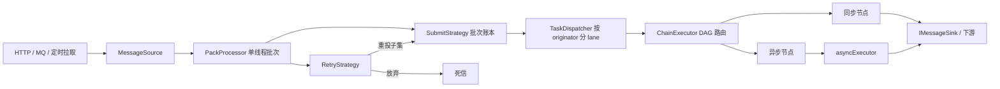

# rule-engine 规则引擎

面向**事件流**的轻量级规则编排引擎：用 JSON 描述 DAG 规则链，按业务实体保序处理，以批次为单位提交与重试。核心模块零 Spring 依赖，同时提供 Spring Boot Starter 开箱即用。

- 构建：Maven 多模块，Spring Boot 2.7.2，Java 11（core 兼容 Java 8 字节码）
- 依赖：Jackson + SLF4J；Aviator 由 starter 引入

## 1. 模块

| 模块 | 说明 |
| --- | --- |
| `core` | 引擎内核：模型、SPI、DAG 执行、批次运行、集群、观测 |
| `cmp` | Spring Boot Starter：自动装配、节点注册、Aviator 表达式 |
| `example` | 演示应用：HTTP 入口、消防告警链、白盒压测 |
| `web` | 规则链设计器：Vue 3 + Vue Flow，构建产物输出到 example 静态目录 |

## 2. 整体架构

### 2.1 数据流



依赖方向单向：编排层不知道批次，运行层不知道节点逻辑，节点只依赖 `INodeContext`。

### 2.2 一次批次的生命周期

1. `MessageSource.poll(pollSize)` 取一批消息
2. `SubmitStrategy.init` 建立批次内队列（如按 originator 分组）
3. `PackContext` 建账本，逐条投递并登记 `pending`
4. `TaskDispatcher` 按 originator 哈希到 lane，同键串行、异键并行
5. `ChainExecutor` 从入口节点执行 DAG，节点用 `tellNext/tellSuccess/tellFailure` 路由
6. `await(packTimeoutMs)`：全部成功则 `commit`；失败/超时交 `RetryStrategy` 判决，重投子集或写死信后 `commit`

### 2.3 核心组件

| 组件 | 职责 |
| --- | --- |
| `RuleEngine` | 门面，组装注册表、执行器、处理器，暴露 `start/stop/loadChain/submitSync` |
| `MessageSource` | 批次来源，`poll` + `commit` |
| `PackProcessor` | 单线程消费循环，批次超时、重试判决、死信 |
| `SubmitStrategy` | 批次投递方式：`Burst` 全量并发、`SequentialByKey` 按实体串行 |
| `PackContext` | 批次账本：`pending/success/failed`、`CountDownLatch`、fan-out 计数 |
| `TaskDispatcher` | 按 key 路由到固定 lane，保证同键串行 |
| `ChainExecutor` | DAG 路由，负责 `dispatch`、`resume`、嵌套链、`tellSelf` |
| `RuleNode` | 业务扩展点，`init` 解析配置，`onMsg` 处理消息 |

### 2.4 并发与顺序

- **单消费线程**：`rule-consumer` 负责 poll → 投递 → await → commit，批次严格串行。
- **按 originator 分 lane**：`rule-lane-N` 单线程 + 有界队列，同键串行、异键并行；队列满时 `CallerRunsPolicy` 形成反压。
- **异步节点**：耗时 I/O 交给 `ctx.asyncExecutor()`，结束时必须回调 `tellNext/tellFailure`，否则批次会挂到超时。
- **fan-out**：分支派发前先 `onFanOut(totalTargets)`，避免先完成的分支让批次提前收口。

### 2.5 可靠性

- **至少一次投递**：失败重投可能重复执行，业务需按 `RuleMessage.id` 或业务主键幂等。
- **批次超时**：默认 2000ms，超时消息进 `pending`，由重试策略决定重投或死信。
- **死信**：放弃前先写 `IDeadLetterSink`，因为 `commit` 之后消息无法找回。

| 重试策略 | 重投成功 | 重投失败 | 重投超时 |
| --- | --- | --- | --- |
| `skipAll()` | 否 | 否 | 否 |
| `retryFailed()`（默认） | 否 | 是 | 否 |
| `retryFailedAndTimeout()` | 否 | 是 | 是 |
| `retryAll()` | 是 | 是 | 是 |

默认最多 3 次，间隔 1000ms 起，指数退避封顶 5000ms。

### 2.6 分布式与观测

- 跨实例：`DistributedIMessageSink` 本地优先、远程序列化投递；`PartitionedMessageSource` 消费本实例分区；`ChainExecutor.resume` 从关系继续，不重复执行上游节点。
- 观测：`EngineObserver` 统一上报节点耗时、批次、死信；`EngineObserver.Stats` 是默认实现，替换为自定义 Bean 即可接管。

## 3. 快速开始

### 3.1 引入依赖

```xml
<dependency>
    <groupId>io.fire</groupId>
    <artifactId>rule-engine-spring-boot-starter</artifactId>
    <version>1.0.0</version>
</dependency>
```

不用 Spring 时只引 `rule-engine-core`，手动 `RuleEngine.builder()` 组装。

### 3.2 配置

```yaml
rule:
  engine:
    enabled: true
    default-chain-id: fireAlarm
    chain-config-path: fire-alarm-chain.json
    poll-size: 64
    pack-timeout-ms: 10000
    auto-start: true
    expression-engine: aviator   # aviator | simple
```

`chain-config-path` 指向 classpath 资源；未配置 `default-chain-id` 时自动取 JSON 顶层的 `id`。

### 3.3 编写节点

```java
@NodeComponent(type = "filter", category = "filter",
        description = "按条件分流到 True / False",
        relations = {"True", "False"})
public class FilterNode implements RuleNode {

    private String expr;

    @Override
    public void init(INodeContext ctx, NodeConfig config) throws NodeException {
        this.expr = config.get("expr");
        if (expr == null || expr.isEmpty()) {
            throw new NodeException("filter 节点缺少 expr 配置", true);
        }
    }

    @Override
    public void onMsg(INodeContext ctx, RuleMessage msg) throws Exception {
        boolean pass = ctx.expressionEngine().evaluate(expr, msg);
        ctx.tellNext(msg, pass ? "True" : "False");
    }
}
```

约定：

- `init` 只做配置解析与资源准备。加载器调用的是 `init(null, config)`，不能用 `ctx`。
- `onMsg` 的每个分支都必须有出口（`tellNext/tellSuccess/tellFailure/ack`），否则消息会挂到超时。
- 耗时 I/O 交给 `ctx.asyncExecutor()`，并在任务开始时检查 `msg.isValid()`。
- 节点必须无状态，状态放 `metadata` 或外部存储。

### 3.4 编写规则链

```json
{
  "id": "fireAlarm",
  "name": "消防隐患智能处置链",
  "nodes": {
    "recv":       { "type": "log", "props": { "prefix": "[INPUT]" } },
    "validate":   { "type": "deviceValidate" },
    "riskFilter": { "type": "filter",
                    "props": { "expr": "telemetry.temperature > threshold.temperature" } },
    "enrich":     { "type": "riskEnrich", "props": { "criticalScore": "80" } },
    "archive":    { "type": "archive" }
  },
  "edges": {
    "recv":       [ { "to": "validate" } ],
    "validate":   [ { "to": "riskFilter", "relation": "Valid" },
                    { "to": "archive", "relation": "Invalid" } ],
    "riskFilter": [ { "to": "enrich", "relation": "True" },
                    { "to": "archive", "relation": "False" } ]
  },
  "entry": [ "recv" ]
}
```

- `edges[].relation` 省略时默认 `Success`；没有下游接住的关系视为链路终点，自动 `ack`。
- `entry` 省略时取第一个节点。
- `customRelations = true` 的节点（如 AI 判定）关系名运行时确定，下游名必须与返回值一致。

示例模块的完整链路还包含 `aiJudge`、`notify`、`persist` 三个异步节点，见 `example/src/main/resources/fire-alarm-chain.json`。

### 3.5 投递消息与注入能力

`originator` 是分区键，决定串行粒度：

```java
RuleMessage msg = RuleMessage.newMessage()
        .type("DEVICE_TELEMETRY")
        .originator(deviceId)          // 同一设备串行
        .payload(payloadJson)
        .build();

callBackSource.add(new Envelope(msg));   // 自定义 MessageSource
// 或 inMemorySource.offer(msg)
// 或 engine.submitSync(msg)             同步调试单条
```

业务服务通过 `RuleEngineCustomizer` 注入，节点用 `ctx.capability(Xxx.class)` 取用：

```java
@Component
public class MyCustomizer implements RuleEngineCustomizer {
    @Override
    public void customize(RuleEngine.Builder builder) {
        builder.capability(RiskService.class, riskService);
    }
}
```

### 3.6 运行示例

```powershell
mvn -pl example -am package -DskipTests
java -jar example/target/rule-engine-example-1.0.0.jar `
  --spring.profiles.active=stress --server.port=18080

Invoke-RestMethod -Method Post -Uri http://localhost:18080/ruleExecute `
  -ContentType 'application/json' `
  -InFile example/src/main/resources/sample-telemetry.json
```

`/ruleExecute` 会补全缺失的 `traceId` 与 `event` 头，并以 `device.deviceId` 作为 `originator`。

### 3.7 可视化编排（规则链设计器）

`web/` 是基于 Vue 3 + Vue Flow 的 DAG 设计器，构建产物直接写入 `example/src/main/resources/static/designer`，
随示例应用一起打包：

```powershell
cd web
npm install
npm run build        # 输出到 example/src/main/resources/static/designer
cd ..
mvn -pl example -am package -DskipTests
java -jar example/target/rule-engine-example-1.0.0.jar --server.port=18080
```

打开 <http://localhost:18080/designer/> 即可拖拽编排。

- 节点库来自 `GET /designer/nodes`（由 `INodeRegistry` 定义生成），接口不可用时回退内置目录。
- “加载示例”读取 `GET /designer/example`，返回引擎当前加载的规则链 JSON。
- 节点右侧每个圆点是一个出口，圆点名称即 `relation`；`aiDecision` 等自定义关系节点先在右侧面板添加出口名。
- 导出的 JSON 与 `JsonChainLoader` 格式一致，可直接放到 classpath 交给 `rule.engine.chain-config-path`。
- 画布坐标只存在于设计器，导出文件不含坐标；“自动布局”按入口做 BFS 分层。

前端单独开发（`/designer/nodes`、`/designer/example` 代理到 18080）：

```powershell
cd web
npm run dev          # http://localhost:5173/designer/
```

## 4. 配置项

| 配置 | 默认值 | 说明 |
| --- | --- | --- |
| `rule.engine.enabled` | `true` | 关闭后不创建引擎 |
| `rule.engine.default-chain-id` | 无 | 消息未带 `chainId` 时使用 |
| `rule.engine.chain-config-path` | 无 | classpath 下的规则链 JSON |
| `rule.engine.poll-size` | `256` | 单批最多拉取条数 |
| `rule.engine.pack-timeout-ms` | `2000` | 批次等待超时 |
| `rule.engine.auto-start` | `true` | 启动后自动消费 |
| `rule.engine.expression-engine` | `aviator` | `aviator` 或 `simple` |
| `example.enabled` | `false` | 开启模拟网关 `PullSource`，与 HTTP 回调合并 |
| `example.stress.enabled` | `false` | 开启压测调优与 `/stress/*` 端点 |
| `example.stress.lane-count` | `0` | lane 数，`0` 取 `max(4, CPU*2)` |
| `example.stress.async-pool-size` | `0` | 异步线程数，`0` 取 `max(4, CPU*2)` |

## 5. 使用场景

| 场景 | `originator` | 建模要点 |
| --- | --- | --- |
| 物联网设备告警 | `deviceId` | 同设备状态更新保序；AI/通知节点异步化；批次超时隔离慢设备 |
| 实时风控 | 用户 / 订单 / 卡号 | 同一主体行为序列保序；外部画像、名单、模型走异步池 |
| 事件驱动集成 | 业务主键 | 规则链作为路由器，按类型分流到工单、短信、数仓 |
| 边缘网关 | 设备 ID | core 无 Spring 依赖，可直接嵌入；有界队列形成反压 |
| 异步审批流 | 流程 ID | `tellSelf` 延迟唤醒，`input/output` 嵌套子链；注意延迟任务不持久化 |
| 规则可配置系统 | 业务主键 | JSON 持久化 + `@NodeComponent` 元数据驱动前端画布与表单 |

## 7. 扩展点

| 扩展点 | 接口 |
| --- | --- |
| 节点 | `RuleNode` + `@NodeComponent` |
| 表达式 | `IExpressionEngine`（默认 Aviator） |
| 消息源 | `MessageSource`（HTTP 队列、Kafka、定时拉取） |
| 提交策略 | `SubmitStrategy` |
| 调度器 | `TaskDispatcher` |
| 重试 | `RetryStrategy` |
| 死信 | `IDeadLetterSink` |
| 观测 | `EngineObserver` |
| 跨实例 | `PartitionRouter`、`IMessageSink`、`MessageSerializer` |
| 引擎定制 | `RuleEngineCustomizer` |

## 8. 约束与最佳实践

1. **`originator` 选业务主键**：决定串行粒度，选错要么丢顺序，要么把并发压成 1。
2. **`poll-size` 与 `pack-timeout` 一起调**：批太大，单条慢消息拖长整批；批太小，调度开销占比升高。`pack-timeout` 应大于链路 P99。
3. **节点无状态、分支有出口、I/O 走异步**：这三条是稳定运行的前提。
4. **至少一次语义要求业务幂等**：用 `RuleMessage.id` 或业务唯一键去重。
5. **热点实体必须单独压测**：用 `HOT_DEVICE=true` 验证单 lane 上限，再决定 lane 数与 originator 粒度。
6. **已知限制**：`tellSelf` 不持久化，重启丢失；`InMemoryMessageSource` 不持久化；`KafkaMessageSource` 是骨架实现；Spring 节点为单例，多链复用同类型节点时 `props` 会互相覆盖。
