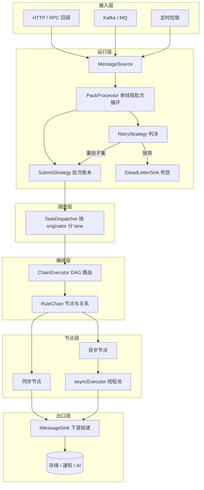
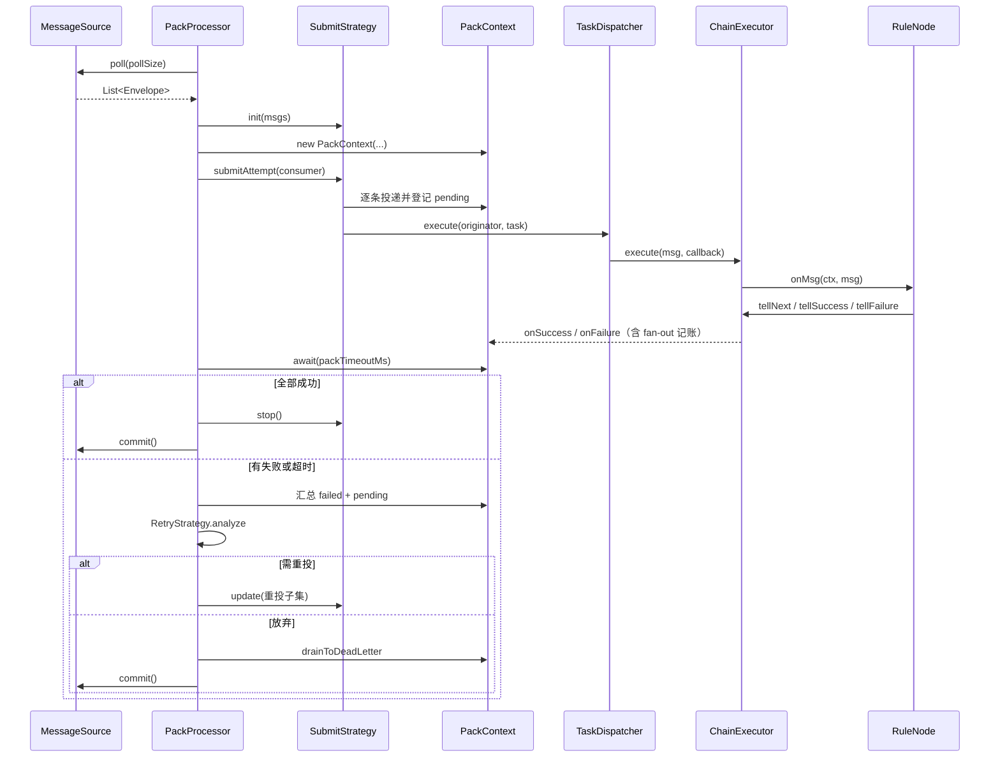
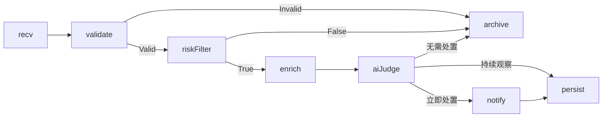

# rule-engine 规则引擎

一个面向**事件流**的轻量级规则编排引擎：用 JSON 描述 DAG 规则链，按业务实体保序处理，以批次为单位提交与重试，核心模块可脱离 Spring 独立运行，同时提供 Spring Boot Starter 开箱即用。

设计参照 ThingsBoard Rule Engine 的“队列 + 批次 + 节点”模型，但去掉了 Actor 与 protobuf，保留了三件最关键的事：**同一实体串行、批次级超时、失败可重投**。

- 构建：Maven 多模块，Spring Boot 2.7.2，Java 11（core 保持 Java 8 字节码兼容）
- 核心依赖：Jackson + SLF4J；表达式引擎 Aviator 仅在 starter 中引入

---

## 目录

1. [项目定位](#1-项目定位)
2. [模块结构](#2-模块结构)
3. [整体架构](#3-整体架构)
4. [快速开始](#4-快速开始)
5. [规则链 DSL](#5-规则链-dsl)
6. [配置项](#6-配置项)
7. [示例：消防隐患智能处置](#7-示例消防隐患智能处置)
8. [使用场景](#8-使用场景)
9. [压测与观测](#9-压测与观测)
10. [扩展点](#10-扩展点)
11. [最佳实践与已知限制](#11-最佳实践与已知限制)

---

## 1. 项目定位

规则引擎解决的是“**消息进来之后按什么顺序、走哪些步骤、失败了怎么办**”这三个问题。

它适合这样的业务：消息天然带一个业务主键（设备 ID、订单号、用户 ID），同一主键的消息必须按顺序处理，不同主键要能并行；处理链路包含分支、异步 I/O、外部服务调用；个别消息失败不能拖垮整批，也不能悄悄丢掉。

核心能力：

| 能力 | 实现 |
| --- | --- |
| 规则编排 | JSON 定义 DAG，节点 + 关系边 + 入口 |
| 实体保序 | 按 `originator` 哈希到固定 lane，同键串行、异键并行 |
| 批处理 | 单线程 `poll` 一批，整批 `await`，统一 `commit` |
| 故障隔离 | 批次级超时，慢消息不拖累整批 |
| 重试与死信 | `RetryStrategy` 三标志组合，未恢复消息进死信 |
| 异步节点 | 耗时 I/O 走独立线程池，不占调度线程 |
| 可观测 | `EngineObserver` 记录批次、节点耗时、死信 |
| 水平扩展 | 分区路由 + 跨实例投递 + 从关系恢复 |
| 可嵌入 | core 零 Spring 依赖，starter 自动装配 |

---

## 2. 模块结构

```
rule-engine/
├── core/       规则引擎内核：模型、SPI、DAG 执行、运行层、集群、观测
├── cmp/        Spring Boot Starter：自动配置、节点注册、Aviator 表达式
└── example/    演示应用：HTTP 入口、消防告警链、压测支持
```

| 模块 | Maven 坐标 | 职责 | 依赖 |
| --- | --- | --- | --- |
| `core` | `io.fire:rule-engine-core:1.0.0` | 引擎全部运行时能力，不依赖 Spring | Jackson、SLF4J |
| `cmp` | `io.fire:rule-engine-spring-boot-starter:1.0.0` | 自动装配 `RuleEngine`、收集节点 Bean、提供 Aviator | core、Spring Boot、Aviator |
| `example` | `io.fire:rule-engine-example:1.0.0` | 可运行的演示服务与白盒压测用例 | starter、Web |

`core` 内部按职责分包：

| 包 | 内容 |
| --- | --- |
| `model` | `RuleMessage`、`MetaData`、`ProcessingStack`、`PackCallback` |
| `spi` | `RuleNode`、`INodeContext`、`INodeRegistry`、`IExpressionEngine`、`IMessageSink`、`IDeadLetterSink`、`NodeConfig` |
| `chain` | `RuleChain`（DAG）、`ChainExecutor`、`DefaultNodeContext` |
| `runtime` | `PackProcessor`、`PackContext`、`Envelope`、`RetryStrategy`、`MessageSource` |
| `runtime.strategy` | `BurstSubmitStrategy`、`SequentialByKeySubmitStrategy` |
| `runtime.dispatcher` | `KeyOrderedDispatcher`、`SameThreadOrderedDispatcher`、`DirectTaskDispatcher`、`ActorStyleDispatcher` |
| `config` | `JsonChainLoader` |
| `cluster` | 分区路由、跨实例投递、Kafka 消息源骨架、内存 broker |
| `observability` | `EngineObserver`（含 `Stats` 实现） |
| `nodes` | `LogNode`、`TransformNode`、`SimpleExpressionEngine` |

---

## 3. 整体架构

### 3.1 分层视图



依赖方向严格单向：编排层不知道批次，运行层不知道节点逻辑，节点只依赖 `INodeContext`。因此三层可以独立替换。

### 3.2 一次批次的生命周期



关键点：

1. **批次是提交单位**。成功才 `commit`，避免“处理失败但 offset 已推进”的丢消息。
2. **批次有独立超时**。`await(packTimeoutMs)` 到点即判超时，未回调的消息进入 `pending`，不会无限等待。
3. **重试只重投子集**。默认 `retryFailed` 只重投失败项，成功项不会重复执行。
4. **放弃前先写死信**。`commit` 之后消息就找不回来了，所以死信必须在此之前落库/落日志。

### 3.3 核心组件

| 组件 | 位置 | 职责 |
| --- | --- | --- |
| `RuleEngine` | core | 门面，组装注册表、执行器、处理器，暴露 `start/stop/loadChain/submitSync` |
| `MessageSource` | core | 批次来源，`poll` + `commit`；可对接 HTTP 队列、Kafka、定时拉取 |
| `PackProcessor` | core | 单线程消费循环，批次超时、重试判决、死信 |
| `SubmitStrategy` | core | 决定一批消息怎么投：`Burst` 全量并发、`SequentialByKey` 按实体串行 |
| `PackContext` | core | 批次账本：`pending/success/failed`、`CountDownLatch`、fan-out 计数 |
| `TaskDispatcher` | core | 按 key 路由到固定 lane，保证同键串行、异键并行 |
| `ChainExecutor` | core | DAG 路由，负责 `dispatch`、`resume`、嵌套链、`tellSelf` |
| `RuleChain` | core | 节点表 + 邻接表 + 入口节点 |
| `RuleNode` | core | 业务扩展点，`init` 解析配置，`onMsg` 处理消息 |
| `INodeContext` | core | 节点能做什么：`tellNext/tellSuccess/tellFailure/ack/enqueueForTellNext/input/output` |
| `RetryStrategy` | core | 整批失败后的判决：重投失败/超时/成功，或放弃 |
| `EngineObserver` | core | 批次与节点级观测回调 |
| `IDeadLetterSink` | core | 死信出口，默认 `LoggingDeadLetterSink` |

### 3.4 并发与顺序模型

引擎把并发拆成三层，彼此不重叠：

```
第 1 层：单消费线程
  rule-consumer  只做 poll → 投递 → await → commit，保证批次顺序

第 2 层：按 originator 分 lane
  rule-lane-0 ... rule-lane-N
  同一个设备恒定落到同一 lane，串行执行；不同设备并行

第 3 层：异步节点线程池
  默认 max(4, CPU*2)，压力 profile 可配置
  只承载耗时 I/O，不占 lane 线程
```

为什么这样分：

- **不加锁**。用“固定通道 + 哈希路由”替代 `synchronized`，同键天然串行。
- **有界队列 + `CallerRunsPolicy`**。lane 队列满时由提交方自己执行，形成反压而不是 OOM。
- **异步节点必须回跳**。异步任务结束时仍要通过 `ctx.tellNext/tellFailure` 回调，否则批次会挂到超时。
- **fan-out 先声明后派发**。一个节点分出多条分支时，先 `onFanOut(totalTargets)` 再逐个 dispatch，避免先完成的分支让批次提前收口。

线程清单：

| 线程 | 来源 | 作用 |
| --- | --- | --- |
| `rule-consumer` | `RuleEngine` | 批次消费循环 |
| `rule-lane-N` | `KeyOrderedDispatcher` | 实体串行执行 |
| `rule-self-scheduler` | `ChainExecutor` | `tellSelf` 延迟任务 |
| 自定义线程池 | `RuleEngine.Builder.asyncPool` | 异步节点，压测 profile 中命名为 `stress-async-N` |

### 3.5 可靠性模型

- **投递语义：至少一次（at-least-once）**。失败重投可能造成重复执行，业务节点需按 `RuleMessage.id` 或业务主键做幂等。
- **批次超时**：默认 2000ms，演示配置 10000ms。超时消息进入 `pending`，由重试策略决定重投或死信。
- **重试策略**：

| 工厂方法 | 重投成功 | 重投失败 | 重投超时 | 适用场景 |
| --- | --- | --- | --- | --- |
| `skipAll()` | 否 | 否 | 否 | 开发演示，快进快出 |
| `retryFailed()` | 否 | 是 | 否 | 默认，避免成功项重复 |
| `retryFailedAndTimeout()` | 否 | 是 | 是 | 节点耗时波动大 |
| `retryAll()` | 是 | 是 | 是 | 强一致、可幂等的场景 |

默认参数：最多 3 次，间隔 1000ms 起，指数退避封顶 5000ms。失败率超过阈值可提前放弃，避免 DB 故障时整批空转。

- **死信**：放弃的消息带原因码写入 `IDeadLetterSink`。默认 `LoggingDeadLetterSink` 打印日志，生产应替换为落库或 MQ。
- **优雅停止**：`RuleEngine.stop()` 先停消费循环，再关闭执行器、调度器与线程池；`PackProcessor.stopAndAwait` 可等当前批次结束。

### 3.6 分布式扩展

单机时 `tellNext` 只在内存中流转。需要跨实例时，引擎提供对称的两侧：

```
生产侧：DistributedIMessageSink
  目标分区在本实例 → 直接内存 dispatch（不序列化、不走网络）
  目标分区在别的实例 → 序列化后交给 RemoteTransport

消费侧：PartitionedMessageSource
  poll 本实例负责的分区 → 反序列化 → Envelope（携带 relations）→ PackProcessor
```

要点：

- 分区键必须是 `originator`，否则“同一设备有序”的前提被破坏。
- 跨实例投递时关系名随消息一起传递，消费端用 `ChainExecutor.resume()` **从该节点的下游继续**，不会重复执行上游节点。
- `HashPartitionRouter` + `InMemoryClusterBroker` 可在单进程内模拟多实例，便于测试。
- `KafkaMessageSource` 目前是骨架实现（`poll` 中的 kafka-clients 调用已注释），接入真实 Kafka 需补全并手动提交 offset。

启用方式：

```java
RuleEngine.builder()
    .partitionRouter(new HashPartitionRouter(nodeId, partitionCount, ownedPartitions))
    .messageSerializer(new JsonMessageSerializer())
    .remoteTransport(transport)
    // ...
    .build();
```

### 3.7 观测

`EngineObserver` 是引擎唯一的观测出口，默认实现 `Stats` 会记录：

- 每个节点的调用次数、平均耗时、错误数、死信数
- 批次成功/失败/超时次数
- 死信原因分布
- `report()` 输出可直接打印的文本报告

替换方式：在 Spring 中声明自己的 `EngineObserver` Bean 即可（自动配置带 `@ConditionalOnMissingBean`）。示例模块的 `StressEngineObserver` 就是在此之上增加了 TPS 窗口、死信明细与 JSON 快照。

---

## 4. 快速开始

### 4.1 引入依赖

```xml
<dependency>
    <groupId>io.fire</groupId>
    <artifactId>rule-engine-spring-boot-starter</artifactId>
    <version>1.0.0</version>
</dependency>
```

若不用 Spring，只引 `rule-engine-core`，手动 `RuleEngine.builder()` 组装。

### 4.2 配置

`application.yml`：

```yaml
rule:
  engine:
    enabled: true
    default-chain-id: fireAlarm
    chain-config-path: fire-alarm-chain.json
    poll-size: 64
    pack-timeout-ms: 10000
    auto-start: true
    expression-engine: aviator   # aviator | simple
```

`chain-config-path` 指向 classpath 资源。未显式配置 `default-chain-id` 时，自动取 JSON 顶层的 `id`。

### 4.3 编写节点

节点是唯一需要写业务代码的地方。实现 `RuleNode`，用 `@NodeComponent` 声明可被规则链引用的 `type`：

```java
@NodeComponent(type = "filter", category = "filter",
        description = "按条件分流到 True / False",
        relations = {"True", "False"})
public class FilterNode implements RuleNode {

    private String expr;

    @Override
    public void init(INodeContext ctx, NodeConfig config) throws NodeException {
        this.expr = config.get("expr");
        if (expr == null || expr.isEmpty()) {
            throw new NodeException("filter 节点缺少 expr 配置", true);
        }
    }

    @Override
    public void onMsg(INodeContext ctx, RuleMessage msg) throws Exception {
        boolean pass = ctx.expressionEngine().evaluate(expr, msg);
        ctx.tellNext(msg, pass ? "True" : "False");
    }
}
```

约定：

- `init` 做重活：编译脚本、建连接、解析 `props`。注意 `JsonChainLoader` 调用的是 `init(null, config)`，此时 `ctx` 为 `null`，不能依赖上下文。
- `onMsg` 的**每个分支都要有出口**：`tellSuccess`、`tellNext`、`tellFailure`、`ack` 至少调用一个。漏掉会让消息挂到批次超时。
- 耗时 I/O 必须交给 `ctx.asyncExecutor()`，并在异步任务结束时回调路由方法。
- 异步任务开始前检查 `msg.isValid()`，批次已超时/取消时直接放弃。
- 节点**必须无状态**。需要跨消息保存的状态放到消息 `metadata` 或外部存储。

异步节点的典型写法（节选自 `AiDecisionNode`）：

```java
@Override
public void onMsg(INodeContext ctx, RuleMessage msg) throws Exception {
    DecisionService service = ctx.capability(DecisionService.class);
    if (service == null) {
        ctx.tellFailure(msg, new IllegalStateException("未注入 DecisionService"));
        return;
    }
    ctx.asyncExecutor().execute(() -> {
        try {
            if (!msg.isValid()) {
                return;
            }
            String relation = service.decide(agent, msg);
            ctx.tellNext(msg, relation);
        } catch (Exception e) {
            ctx.tellFailure(msg, e);
        }
    });
}
```

### 4.4 编写规则链

```json
{
  "id": "fireAlarm",
  "name": "消防隐患智能处置链",
  "nodes": {
    "recv":     { "type": "log", "props": { "prefix": "[INPUT]" } },
    "validate": { "type": "deviceValidate" },
    "riskFilter": {
      "type": "filter",
      "props": { "expr": "telemetry.temperature > threshold.temperature" }
    },
    "enrich":  { "type": "riskEnrich", "props": { "criticalScore": "80" } },
    "aiJudge": { "type": "aiDecision", "props": { "agent": "riskJudge" } },
    "notify":  { "type": "notify" },
    "persist": { "type": "asyncSink", "props": { "target": "tdengine" } },
    "archive": { "type": "archive" }
  },
  "edges": {
    "recv":     [ { "to": "validate" } ],
    "validate": [ { "to": "riskFilter", "relation": "Valid" },
                  { "to": "archive", "relation": "Invalid" } ],
    "riskFilter": [ { "to": "enrich", "relation": "True" },
                    { "to": "archive", "relation": "False" } ],
    "enrich":   [ { "to": "aiJudge" } ],
    "aiJudge":  [ { "to": "notify", "relation": "立即处置" },
                  { "to": "persist", "relation": "持续观察" },
                  { "to": "archive", "relation": "无需处置" } ],
    "notify":   [ { "to": "persist" } ]
  },
  "entry": [ "recv" ]
}
```

规则：

- `nodes` 的 key 是节点 ID，`type` 对应 `@NodeComponent(type=...)`。
- `edges` 的 `relation` 省略时默认 `"Success"`，串联场景可以不写。
- 一个节点可以有多条同关系边，形成 fan-out。
- 没有下游接住的关系会被视为链路终点，自动 `ack`。
- `entry` 省略时取第一个节点。

### 4.5 投递消息

`originator` 是分区键，决定串行粒度，也是顺序保证的根因：

```java
RuleMessage msg = RuleMessage.newMessage()
        .type("DEVICE_TELEMETRY")
        .originator(deviceId)          // 同一设备串行
        .payload(payloadJson)
        .metaData(metaData)
        .build();

// 三选一，取决于消息源类型
callBackSource.add(new Envelope(msg));   // 自定义消息源，如 HTTP 回调
inMemorySource.offer(msg);               // InMemoryMessageSource
engine.submitSync(msg);                  // 绕过队列，同步调试单条
```

Spring 环境下通常自定义一个 `MessageSource` Bean（示例中的 `CallBackSource`），HTTP 接口收到请求后入队即可。由于自动配置带 `@ConditionalOnMissingBean(MessageSource.class)`，自定义消息源会自动生效。

### 4.6 注入业务能力

节点不应直接依赖 Spring 容器。把业务服务通过 `RuleEngineCustomizer` 注入为 capability：

```java
@Component
public class MyRuleEngineCustomizer implements RuleEngineCustomizer {

    private final RiskService riskService;

    public MyRuleEngineCustomizer(RiskService riskService) {
        this.riskService = riskService;
    }

    @Override
    public void customize(RuleEngine.Builder builder) {
        builder.capability(RiskService.class, riskService);
    }
}
```

节点内用 `ctx.capability(RiskService.class)` 取用。多个 customizer 按 `@Order` 排序执行。

### 4.7 非 Spring 内嵌用法

```java
// 注册表：Spring 环境由 SpringNodeRegistry 收集 Bean；
// 纯 core 环境可实现 INodeRegistry，把 type 映射到节点实例。
INodeRegistry registry = myRegistry();

RuleEngine engine = RuleEngine.builder()
        .registry(registry)
        .expressionEngine(new SimpleExpressionEngine())
        .source(new InMemoryMessageSource("main"))
        .defaultChainId("demo")
        .submitStrategy(new SequentialByKeySubmitStrategy())
        .build();

engine.loadChain(chainJson);
engine.start();
engine.submitSync(msg);
engine.stop();
```

core 也提供 JDK SPI 发现机制：实现 `RuleNodeDefinition`，并把实现类写入 `META-INF/services/io.fire.rule.spi.RuleNodeDefinition`，再用 `NodeRegistry.defaultRegistry()` 构建注册表。

### 4.8 启动示例应用

```bash
mvn -pl example -am package -DskipTests
java -jar example/target/rule-engine-example-1.0.0.jar \
  --spring.profiles.active=stress --server.port=18080
```

投递一条样例报文（PowerShell）：

```powershell
Invoke-RestMethod -Method Post -Uri http://localhost:18080/ruleExecute `
  -ContentType 'application/json' `
  -InFile example/src/main/resources/sample-telemetry.json
```

返回：

```json
{
  "accepted": true,
  "traceId": "trace-1760000000000-ab12cd34",
  "deviceId": "DEV-FIRE-001",
  "chainId": "fireAlarm"
}
```

`/ruleExecute` 会补全缺失的 `traceId` 与 `event` 头，并以 `device.deviceId` 作为 `originator`。

---

## 5. 规则链 DSL

| 字段 | 必填 | 说明 |
| --- | --- | --- |
| `id` | 是 | 链唯一标识，消息的 `chainId` 对应此值 |
| `name` | 否 | 展示名，缺省等于 `id` |
| `nodes` | 是 | 节点表，key 为节点 ID |
| `nodes[].type` | 是 | 节点类型，对应 `@NodeComponent(type)` |
| `nodes[].props` | 否 | 节点配置，值统一按字符串解析 |
| `edges` | 否 | 邻接表，key 为上游节点 ID |
| `edges[].to` | 是 | 下游节点 ID，必须存在 |
| `edges[].relation` | 否 | 关系名，默认 `Success` |
| `entry` | 否 | 入口节点列表，缺省取第一个节点 |

关系名由节点决定：

- 普通节点默认使用 `Success` / `Failure`。
- 声明了 `relations = {"True","False"}` 的节点，下游必须连到对应关系。
- `customRelations = true` 表示关系名运行时才确定（如 AI 判定），加载时不校验下游。此时下游关系名必须与运行时返回值完全一致。

---

## 6. 配置项

### 6.1 引擎配置（`rule.engine`）

| 配置 | 默认值 | 说明 |
| --- | --- | --- |
| `enabled` | `true` | 关闭后不创建 `RuleEngine` |
| `default-chain-id` | 无 | 消息未带 `chainId` 时使用 |
| `chain-config-path` | 无 | classpath 下的规则链 JSON |
| `poll-size` | `256` | 单批最多拉取条数 |
| `pack-timeout-ms` | `2000` | 批次等待超时 |
| `auto-start` | `true` | 容器启动后自动开始消费 |
| `expression-engine` | `aviator` | `aviator` 或 `simple` |

### 6.2 演示应用配置（`example`）

| 配置 | 默认值 | 说明 |
| --- | --- | --- |
| `example.enabled` | `false` | `true` 时额外启用 `PullSource` 模拟网关，并与 HTTP 回调合并 |
| `example.pull-interval-seconds` | `5` | 模拟网关拉取间隔 |

### 6.3 压测配置（`example.stress`，仅 stress profile）

| 配置 | 默认值 | 说明 |
| --- | --- | --- |
| `enabled` | `false` | 开启压测调优与观测端点 |
| `lane-count` | `0` | 调度 lane 数，`0` 表示 `max(4, CPU*2)` |
| `lane-queue-capacity` | `4096` | 单 lane 队列长度 |
| `async-pool-size` | `0` | 异步线程数，`0` 表示 `max(4, CPU*2)` |
| `async-queue-capacity` | `4096` | 异步池队列长度 |

---

## 7. 示例：消防隐患智能处置

`example` 模拟一条真实的消防告警链路：



| 节点 | 类型 | 作用 |
| --- | --- | --- |
| `recv` | `log` | 记录入口报文 |
| `validate` | `deviceValidate` | 校验设备档案与遥测完整性，分流 `Valid/Invalid` |
| `riskFilter` | `filter` | 用表达式比较温度、烟雾浓度、CO 与阈值 |
| `enrich` | `riskEnrich` | 计算风险评分，写入 metadata |
| `aiJudge` | `aiDecision` | 异步调用智能体，结论直接作为关系名 |
| `notify` | `notify` | 异步通知，成功后继续 |
| `persist` | `asyncSink` | 异步写入 TSDB |
| `archive` | `archive` | 归档低风险/无效数据 |

报文结构（`sample-telemetry.json`）：

```json
{
  "event":   { "eventId": "...", "type": "DEVICE_TELEMETRY", "source": "HTTP_CALLBACK" },
  "device":  { "deviceId": "DEV-FIRE-001", "building": "...", "status": { "online": true } },
  "telemetry": { "temperature": 118.4, "smokeDensity": 1.12, "coLevel": 68.5 },
  "threshold": { "temperature": 60, "smokeDensity": 0.8, "coLevel": 30 },
  "window":  { "recentPoints": [ ... ] }
}
```

运行后可在 `MockSinkHandler` 看到按 `target` 记录的下游写入结果，内存中最多保留 200 条。

---

## 8. 使用场景

### 8.1 物联网设备告警与联动

设备遥测天然带 `deviceId`，同一设备的状态更新必须有序：先上线、再测温、再告警。把 `deviceId` 设为 `originator`，同一设备的消息在固定 lane 串行，不同设备并行。批次超时可防止某台设备调用外部 AI 服务卡死拖垮整批。

典型链路：校验 → 阈值过滤 → 风险评分 → AI 研判 → 通知 → 落库 → 归档。

### 8.2 实时风控与反欺诈

订单号、用户 ID、卡号作为 `originator`，保证同一主体的行为序列不被乱序处理。风控规则经常需要调用外部画像、名单、模型服务，这些节点放进 `asyncExecutor`，同步节点只做轻量判断。失败重投配合业务幂等，能在下游抖动时自动恢复。

### 8.3 事件驱动的系统集成

规则链可以作为“消息路由器”：从 Kafka 消费事件，按 `type` 和内容分流到不同下游系统（工单、短信、数据仓库）。`enqueueForTellNext` 支持跨实例投递，`ChainExecutor.resume` 保证跨实例后从关系继续，不重复执行上游节点。

### 8.4 边缘网关本地规则

核心模块无 Spring 依赖，可直接嵌入边缘程序。规则链 JSON 可由云端下发，节点库按设备能力裁剪。有界队列 + `CallerRunsPolicy` 在资源受限设备上形成自然反压。

### 8.5 异步工作流与人工审批

`tellSelf` 支持延迟投递，`input/output` 支持嵌套子链。审批流可以建模为：提交 → 等待（延迟自唤醒）→ 审批分支 → 归档。注意 `tellSelf` 不落队列，进程重启会丢失，关键超时任务应改为扫描外部状态表。

### 8.6 规则可配置的业务系统

规则链以 JSON 持久化，前端可以做成拖拽画布（格式与 eKuiper 图规则 API 同构）。`@NodeComponent` 自带 `title/category/description/version/relations`，可直接驱动配置表单和节点面板。`RuleNode.upgrade` 用于节点升级后的旧配置迁移。

---

## 9. 压测与观测

示例模块内置一套压测支持，默认关闭，`stress` profile 开启。

### 9.1 启动

```bash
java -jar example/target/rule-engine-example-1.0.0.jar \
  --spring.profiles.active=stress --server.port=18080
```

`application-stress.yml` 的关键调整：

- `poll-size: 64`、`pack-timeout-ms: 20000`
- lane 数由 `lane-count: 0` 自动取 `max(4, CPU*2)`
- 异步池与队列扩容到 4096
- Tomcat 最大线程 400，`accept-count` 1000
- `io.fire` 日志级别降到 `warn`，避免日志成为瓶颈

### 9.2 观测端点

```powershell
Invoke-RestMethod http://localhost:18080/stress/stats
Invoke-RestMethod -Method Post http://localhost:18080/stress/reset
```

`/stress/stats` 返回：

| 区块 | 内容 |
| --- | --- |
| `ingress` | 回调队列长度、待处理批次数 |
| `engine` | 批次轮数、提交批数、消息数、失败/超时/死信、5 秒窗口 TPS、总体 TPS、节点耗时报告 |
| `asyncPool` | 线程数、活跃数、队列长度、完成数、历史最大线程数 |
| `lanes` | lane 数、各 lane 队列长度、总排队数 |
| `jvm` | 堆使用/总额/上限、线程数、运行时长 |

### 9.3 k6 HTTP 压测

脚本：`example/stress/http-stress.js`，复用 `sample-telemetry.json` 作为报文模板。

```bash
k6 run -e BASE_URL=http://localhost:18080 -e RATE=200 -e DURATION=2m \
  example/stress/http-stress.js
```

可调参数：

| 变量 | 默认 | 说明 |
| --- | --- | --- |
| `SCENARIO` | `steady` | `steady` 恒定速率，`ramp` 逐步加压 |
| `RATE` | `200` | 恒定速率（请求/秒） |
| `DURATION` | `2m` | 持续时间 |
| `RAMP_MAX` | `1000` | ramp 场景最大速率 |
| `HOT_DEVICE` | `false` | `true` 时所有请求打同一设备，用于验证热点串行 |
| `CRITICAL_PCT` | `70` | 高危报文占比，控制分支走向 |

脚本会动态生成 `deviceId`（`stress-${VU}-${ITER}`），并在 `setup` 阶段检查 `/stress/stats` 是否可用，避免打到非 stress profile。

阈值：`http_req_failed < 1%`、`http_req_duration p(99) < 300ms`。

### 9.4 白盒压测

`EngineStressTest` 绕过 HTTP，直接向 `CallBackSource` 投递，测量引擎本身的上限：

```bash
mvn -pl example -am test -Dstress.test=true -Dstress.messages=300 -Dstress.devices=32
```

断言：`deadLetters=0`、`timeouts=0`、`messages=total`。输出每轮 TPS 与节点耗时，用于区分“入口瓶颈”和“引擎瓶颈”。

### 9.5 结果解读

- `tpsOverall` 从首次批次提交开始计时，压测前应先 `POST /stress/reset`，否则会混入历史数据与空闲时间。
- `tpsWindow` 是最近 5 秒窗口；压测结束后查会归零，属于正常现象。
- 节点耗时是**调度线程内**的耗时，异步节点只统计提交任务的时间，不包含线程池内的实际等待。
- 关注 `lanes.queueSizes` 是否倾斜：单 lane 堆积说明热点实体过多，可增加 lane 数或拆分 originator 粒度。
- 关注 `asyncPool.queue`：持续增长说明下游 I/O 能力不足，应先扩池或降级，而不是继续加 RPS。

---

## 10. 扩展点

| 扩展点 | 接口 / 方式 | 说明 |
| --- | --- | --- |
| 节点 | `RuleNode` + `@NodeComponent` | 业务处理单元 |
| 表达式 | `IExpressionEngine` | 默认 Aviator，可换 Simple 或自研 |
| 消息源 | `MessageSource` | HTTP 队列、Kafka、定时拉取 |
| 提交策略 | `SubmitStrategy` | `Burst` / `SequentialByKey` / 自定义 |
| 调度器 | `TaskDispatcher` | `KeyOrdered` / `SameThreadOrdered` / `Direct` / `ActorStyle` |
| 重试 | `RetryStrategy` | 三标志组合 + 最大次数 + 失败率阈值 |
| 死信 | `IDeadLetterSink` | 落库、MQ、告警 |
| 观测 | `EngineObserver` | 指标上报、链路追踪 |
| 下游投递 | `IMessageSink` | 分布式跨节点投递 |
| 分区 | `PartitionRouter` | 决定消息归哪个实例 |
| 序列化 | `MessageSerializer` | 跨实例传输格式 |
| 引擎定制 | `RuleEngineCustomizer` | 注入 capability、替换策略、调参 |
| 节点元数据 | `RuleNodeDefinition` | 动态节点（非注解）自定义描述 |

---

## 11. 最佳实践与已知限制

### 11.1 最佳实践

1. **`originator` 选业务主键**。它决定串行粒度，选错要么丢顺序，要么把并发压成 1。
2. **`poll-size` 与 `pack-timeout` 一起调**。吞吐 ≈ 批大小 / 批次耗时（Little's Law）。批太大，单条慢消息会拖长整批；批太小，调度开销占比升高。
3. **`pack-timeout` 要大于链路 P99**。否则正常波动会被误判超时；但也不能无限大，否则节点卡死时批次无法收口。
4. **节点必须无状态**。状态放 `metadata` 或外部存储，否则重试和水平扩展都会出问题。
5. **每个分支都要有出口**。这是最常见的“消息挂到超时”原因。
6. **耗时 I/O 一律异步**。同步节点里 `Thread.sleep`、HTTP 调用会直接占满 lane。
7. **至少一次语义要求业务幂等**。用 `RuleMessage.id` 或业务唯一键去重。
8. **上线前压测热点实体**。用 `HOT_DEVICE=true` 验证单 lane 上限，再决定 lane 数与 `originator` 粒度。

### 11.2 已知限制

- **单消费线程**：批次严格串行。单机吞吐上限取决于批大小与批次耗时，需要更高吞吐时应多实例分区，而不是加消费线程。
- **`tellSelf` 不持久化**：延迟任务只在内存调度，进程重启即丢失。关键超时请用外部状态表 + 扫描补偿。
- **`KafkaMessageSource` 是骨架**：`poll/commit` 中的 kafka-clients 调用已注释，生产接入需自行补全并保证手动提交。
- **`InMemoryMessageSource` 不持久化**：进程崩溃会丢队列中的消息，生产应换成 Kafka 等持久化消息源。
- **节点是 Spring 单例**：同一 `type` 在多条链中使用不同 `props` 时，后加载的配置会覆盖先前的字段值。需要“每条链独立配置”时应扩展注册表，为每条链创建独立节点实例。
- **`JsonChainLoader` 以 `init(null, config)` 初始化节点**：`init` 中不能使用 `INodeContext`。
- **规则链无内置热更新**：没有配置监听机制。可在运行时再次调用 `engine.loadChain(json)`，同 `id` 的链会覆盖注册；节点实例与批次状态不会自动迁移，变更时应配合灰度或重启。
- **内置 SPI 资源文件名与 `ServiceLoader` 类型不一致**：仓库中的文件是 `META-INF/services/io.fire.rule.spi.RuleNode`，而 `NodeRegistry` 通过 `ServiceLoader.load(RuleNodeDefinition.class)` 加载，因此纯 core 的 `defaultRegistry()` 发现不到内置节点。Spring 场景不受影响（自动配置显式声明了 `LogNode`、`TransformNode`）。
- **无内置鉴权与限流**：`/stress/*` 与 `/ruleExecute` 仅用于演示，生产必须自行加网关层保护。

---

## 附：常用命令

```bash
# 编译并跑常规测试（压测用例默认跳过）
mvn -pl example -am test -DskipITs

# 跑白盒压测
mvn -pl example -am test -Dstress.test=true -Dstress.messages=300 -Dstress.devices=32

# 打包
mvn -pl example -am package -DskipTests

# 启动（Java 11）
java -jar example/target/rule-engine-example-1.0.0.jar \
  --spring.profiles.active=stress --server.port=18080
```
